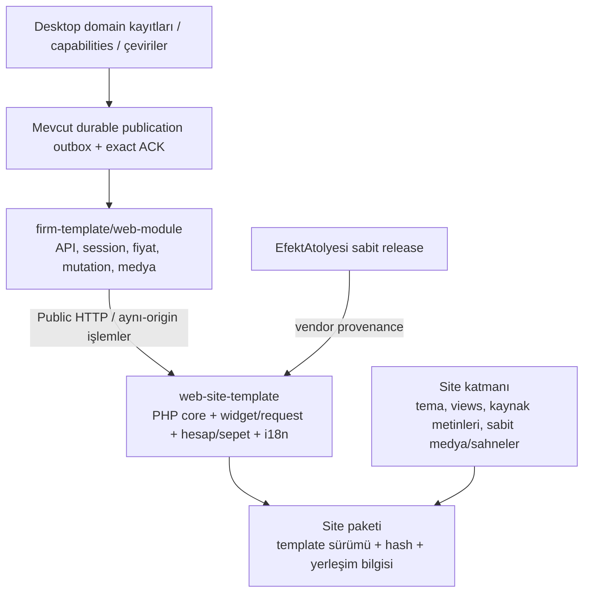

**Audit B sonucu: ortak ve bakımı yapılabilir bir şablon gerçekten var; fakat Teknikel ve Gündoğdu’nun mevcut site girişleri bu şablonu kullanmıyor.** Her iki depoda güncel, hash bakımından temiz `canonical/` kurulumları bulunmasına rağmen kökteki ayrı PHP/JS uygulamaları deploy ediliyor. Bu nedenle ortak şablonun güncellenmesi, kullanılan sitelerdeki widget, dil, yayın ve alışveriş davranışlarını otomatik olarak düzeltmiyor.

**Karar önerim:** yeni bir şablon yazmayın. Mevcut canonical kurulumları tamamlayıp kullanılan giriş/deploy yoluna alın; ortak davranışı değiştiren site katmanlarını kaldırılabilir hale getirin ve bunu paket bütünlüğüyle birlikte gerçek site davranışını sınayan kontrollerle koruyun. Bu merkeziyetçilik işi, desteklenen web akışlarını içeren sürümden önce yapılmalı; bütün görsel tasarımların yeniden yapılması gerekmiyor.

Denetim yalnız yerel kaynakları ve salt okunur kontrolleri kapsadı. Uzak hosting dosyaları, document-root ayarları veya canlı sürüm hash’leri okunmadı. Aşağıdaki “kullanılan yol” tespitleri mevcut giriş dosyaları ve deploy scriptlerinin kanıtıdır; son başarılı canlı deploy’un kanıtı değildir.

**İncelenen durum.** Beş depo da `main` dalındaydı ve hepsinde önceden bulunan değişiklikler vardı. Özellikle Teknikel/Gündoğdu dil düzeltmeleri ve Efekt Atölyesi genişletmeleri çalışma ağacında bulunuyor; rapor yalnız commit edilmiş sürümü anlatmıyor.

| Depo | HEAD |
|---|---|
| YardimciAsistan | `67b2bb3b76a3` |
| Teknikel | `0a27ed47c671` |
| Gündoğdu | `662160d4ce58` |
| BlackSea | `15209cf23efa` |
| EfektAtolyesi | `41a573dc5692` |

Dosya, test, veri, Git veya deployment değişikliği yapılmadı.

---

**Ortak şablon ile sitelerin gerçek ilişkisi.** Canonical sürüm `0.6.1`; manifest **70 ortak dosyayı, toplam 526.263 baytı** izliyor. Sahiplik kapsamı `core/`, ortak public asset’ler, efekt vendor’ı, araçlar, README ve giriş dosyası. Tema, kaynak katalog ve site asset’leri ayrı tutuluyor. Kaynak: [manifest](/home/raistlin/YardimciWorkspace/YardimciAsistan/web-site-template/template-manifest.json:1), [kapsamı belirleyen kod](/home/raistlin/YardimciWorkspace/YardimciAsistan/web-site-template/tools/manifest.mjs:7).

Salt okunur SHA-256 karşılaştırmasının sonucu:

| Yerleşim | Sürüm | Güncel canonical ile eşleşme | Kendi baseline’ına aykırılık | Mevcut giriş/deploy ilişkisi |
|---|---:|---:|---:|---|
| `web-site-template/` | 0.6.1 | 70/70 | 0 | Canonical dağıtım |
| `test-site/landing/deneme/` | 0.6.1 | Eşlenen 66/66 | 0 | Gerçek demo işletme katmanı |
| `teknikel_web/canonical/` | 0.6.1 | 70/70 | 0 | Mevcut site deploy listesinde yok |
| `gundogdu_web/canonical/` | 0.6.1 | 70/70 | 0 | Mevcut site deploy listesinde yok |
| `blacksea_web/` | 0.6.1 | 70/70 | 0 | Kök adapter canonical girişe bağlı |

Demo’nun 66 sayısı eksik kurulum anlamına gelmiyor: eşitleme yalnız giriş, core ve public asset’leri demo yerleşimine taşıyor; README ve bakım araçları bu eşlemenin dışında. [Eşleme ve bütünlük kontrolü](/home/raistlin/YardimciWorkspace/YardimciAsistan/scripts/sync-demo-template.mjs:7).

Teknikel’in kök [index.php](/home/raistlin/YardimciWorkspace/teknikel_web/index.php:17), `inc/layout.php` yükler. Layout, `assets/site.js` ve site içindeki `assets/assistant/widget.js` dosyasını kullanır. [Yükleme sözleşmesi](/home/raistlin/YardimciWorkspace/teknikel_web/inc/layout.php:42). Deploy listesi `assets`, `inc`, mağaza/hesap/sepet ve diğer kök sayfaları taşır; `canonical/` taşımaz. [Deploy allowlist’i](/home/raistlin/YardimciWorkspace/teknikel_web/scripts/deploy-site.sh:22).

Gündoğdu’nun kök [index.php](/home/raistlin/YardimciWorkspace/gundogdu_web/index.php:17), `inc/site.php` yükler. Bu layout, siteye özel dil/yayın JS’i ve `assets/assistant/widget.js` kullanır. [Script yüklemeleri](/home/raistlin/YardimciWorkspace/gundogdu_web/inc/site.php:131). Deploy listesi yine `canonical/` içermez. [Deploy allowlist’i](/home/raistlin/YardimciWorkspace/gundogdu_web/scripts/deploy-site.sh:18).

Üstelik her iki `.htaccess`, `canonical/` yolunu HTTP erişimine kapatıyor. Bu, canonical dizinin şu an alternatif kaynak ağacı olduğunu destekliyor: [Teknikel](/home/raistlin/YardimciWorkspace/teknikel_web/.htaccess:13), [Gündoğdu](/home/raistlin/YardimciWorkspace/gundogdu_web/.htaccess:5).

BlackSea’de ise kök adapter `$templateRoot` belirleyip `public/index.php` çalıştırıyor. Böylece core gerçekten giriş yolunda: [hosting adapter’ı](/home/raistlin/YardimciWorkspace/blacksea_web/index.php:19). Demo’da da `deneme/index.php → entry.php` bağlantısı var: [demo wrapper](/home/raistlin/YardimciWorkspace/YardimciAsistan/test-site/landing/deneme/index.php:1).

**Dolayısıyla hash’leri temiz bir `canonical/` dizini bulmak, sitenin canonical kodu çalıştırdığını kanıtlamıyor.** Bugünkü en önemli yanlış güven ihtimali bu.

---

**Widget sürüklenmesi ve bağımsız düzeltmelerin nedeni.** Güncel ortak widget’ın SHA-256 değeri:

```text
b274bb4bd7602026c74705cb3f9e3f939bc1a18bde5a259c8f1072260d880e9c
```

Bu değer canonical widget, demo build çıktısı ve Gündoğdu’nun kökte kullanılan widget’ında aynı. Teknikel’de kullanılan widget ise:

```text
8201732679ebe95c11ff84c645c01933531182078233e98dae7a11618d22dd00
```

| Kullanılan widget | Boyut | Durum |
|---|---:|---|
| Ortak / Gündoğdu | 167.097 bayt | Byte-identical |
| Teknikel | 224.186 bayt | Farklı bundle; yaklaşık %34 daha büyük |

Teknikel farkı yalnız renk veya CSS değil:

- Bundle başlangıcında geniş bir sabit TR→EN sözlüğü var.
- Dil/locale, `document.documentElement.lang` üzerinden bir kez seçiliyor.
- Güncel ortak widget’ın `site-context` katalog adaptörü yok.
- Siteye özel `setPublication` ve `openRequest` köprüleri eklenmiş.

Kanıt: [Teknikel widget başlangıcı](/home/raistlin/YardimciWorkspace/teknikel_web/assets/assistant/widget.js:1), [köprülerin bulunduğu son satır](/home/raistlin/YardimciWorkspace/teknikel_web/assets/assistant/widget.js:1759). Minify edilmiş dosyada uzun fiziksel satırlar bulunduğundan bu anchor’lar geniş kod bloklarına gider.

Teknikel’in sunum katmanı bu özel köprüleri bekliyor; ortak bundle doğrudan üzerine kopyalanırsa entegrasyon eşdeğer kalmaz. [Köprü bağımlılığı](/home/raistlin/YardimciWorkspace/teknikel_web/assets/assistant/presentation.js:91). README de yeniden kopyalamada köprünün korunmasını açıkça söylüyor. [Bakım talimatı](/home/raistlin/YardimciWorkspace/teknikel_web/README.md:24).

Ayrıca Teknikel, genel bilgi/ürün sorusu için widget’ın dışında ikinci bir form ve gönderim sahibi oluşturmuş. Bu katman telefon normalizasyonunu, validasyonu, idempotency anahtarını, retry durumunu ve `request.php` POST’unu kendisi yönetiyor. [İkinci request sahibi](/home/raistlin/YardimciWorkspace/teknikel_web/assets/assistant/customer-request.js:1).

Bu ayrışmanın bir kısmı artık gereksiz: güncel ortak request akışı **tarihsiz `general_info`** destekliyor. [Kabul edilen türler](/home/raistlin/YardimciWorkspace/YardimciAsistan/test-site/landing/assistant/direct-request-flow.ts:135), [tarih gerektirmeyen dal](/home/raistlin/YardimciWorkspace/YardimciAsistan/test-site/landing/assistant/direct-request-flow.ts:230). Ancak Teknikel’in ürün bağlamlı `price_question` akışı birebir eşdeğer değil; geçişte bu ihtiyaç açıkça karşılanmalı veya destek kapsamı kararlaştırılmalı.

Gündoğdu’da bundle’ın aynı olması olumlu bir kısmi merkeziyetçilik. Fakat çevresindeki entegrasyon ayrılmış:

- `public-data.js` kendi yayın projection’ını üretir.
- `site.js` request türlerini yeniden seçer ve `widget.init(config)` çağırır.
- `language.js` widget DOM’unu sonradan çevirir.
- `MutationObserver` yeniden render edilen widget’a tekrar sunum/çeviri uygular.

Kanıt: [yayın → widget config](/home/raistlin/YardimciWorkspace/gundogdu_web/assets/js/site.js:94), [DOM çevirisi](/home/raistlin/YardimciWorkspace/gundogdu_web/assets/js/language.js:105), [observer](/home/raistlin/YardimciWorkspace/gundogdu_web/assets/js/site.js:88).

Ortak widget ise dili başlangıçta `site-context` üzerinden alıyor; bu bağlam yoksa Türkçeye dönüyor. [Ortak widget dil adaptörü](/home/raistlin/YardimciWorkspace/YardimciAsistan/test-site/landing/assistant/site-language.ts:1). Gündoğdu layout’u `widget-config` üretip farklı bir entegrasyon kullanıyor. Bu nedenle **etiketleri DOM’da çevirmek, widget’ın locale ve gönderilen yanıt dili bağlamını merkezi adaptörle eşitlemiyor**. Bunun kullanıcıya yansıyan bütün sonuçları bu denetimde tarayıcıda sınanmadı; kaynak düzeyindeki ayrım kesin.

Bağımsız düzeltmelerin teknik nedeni böylece açık: **ortak bundle, ortak bootstrap, dil bağlamı ve request sahibinden oluşan tek entegrasyon sözleşmesi birlikte kullanılmamış.** Bazı dosyalar ortak kalırken davranış, sitelerde tekrar kurulmuş.

---

**Dil sistemleri aynı yayın protokolüne bağlanmış, fakat aynı uygulamayı kullanmıyor.**

Canonical yol:

```text
locales/tr.json
  → translation-source
  → Desktop katalog keşfi ve çeviri kayıtları
  → durable publication / business_context.localization
  → PHP language_context
  → site-context
  → PHP + widget + hesap/sepet adaptörleri
```

PHP kaynak kataloğu, hedef dil allowlist’i, kaynak hash’i ve placeholder kontrolünü ortak kodda çözüyor. [Canonical i18n](/home/raistlin/YardimciWorkspace/YardimciAsistan/web-site-template/core/i18n.php:8). Hesap/sepet etkileşimleri aynı bağlamı kullanıyor. [Interaction adaptörü](/home/raistlin/YardimciWorkspace/YardimciAsistan/web-site-template/public/assets/core/interaction-language.js:1).

Teknikel ve Gündoğdu’nun kullanılan yollarında ise:

```text
PHP daima TR
  → siteye özel assets/i18n/tr.json
  → business GET sonrası istemci dil seçimi
  → siteye özel kaynak/hash eşleştirmesi
  → DOM ve public kayıt çevirisi
```

Kaynaklar: [Teknikel PHP dil katmanı](/home/raistlin/YardimciWorkspace/teknikel_web/inc/language.php:8), [Gündoğdu PHP dil katmanı](/home/raistlin/YardimciWorkspace/gundogdu_web/inc/language.php:24), [Teknikel istemci uygulaması](/home/raistlin/YardimciWorkspace/teknikel_web/assets/language.js:132), [Gündoğdu istemci uygulaması](/home/raistlin/YardimciWorkspace/gundogdu_web/assets/js/language.js:185).

Bu düzeltmeler tamamen yanlış değil: yerel hedef dil dosyaları kaldırılmış, diller uygulamanın yayınından açılıyor, hash ve placeholder kontrolleri eklenmiş. Fakat canonical çözümün yanında iki ayrı uygulama daha tutuluyor.

Ölçülen kataloglar:

| Kaynak | Anahtar/metin sayısı |
|---|---:|
| Canonical `locales/tr.json` | 572 |
| Teknikel kullanılan katalog | 568 |
| Gündoğdu kullanılan katalog | 661 |

Teknikel’de 92, Gündoğdu’da 77 kaynak ifade canonical katalogdaki ifadelerle tam aynı. Bu rakamlar çeviri kapsamı veya toplam mantıksal tekrar oranı değildir; yalnız birebir metin kesişimidir.

Ek bakım yükü: Gündoğdu katalog üreticisi regex taraması, `source-phrases.txt` ve elle yazılmış ek ifadeleri birleştiriyor. Bu, katalog ile gerçek UI arasında yeniden eşleştirme işi doğuruyor. [Üretici](/home/raistlin/YardimciWorkspace/gundogdu_web/scripts/build-source-catalog.mjs:10).

Desktop keşif/protokolü zaten merkezî: modül URL’sinin bir üstündeki `translation-source` okunuyor; credential gönderilmiyor, redirect izlenmiyor, hash/revision doğrulanıyor ve yanıt 512 KiB ile sınırlı. **Yeni çeviri servisi gerekmiyor.** [Keşif sahibi](/home/raistlin/YardimciWorkspace/YardimciAsistan/apps/desktop-app/electron/public-site-catalog.ts:19).

Küçük bir belge sürüklenmesi de var: şablon README’si 1.000 anahtar sınırı söylerken PHP ve Desktop doğrulayıcıları 2.048 kabul ediyor. [README](/home/raistlin/YardimciWorkspace/YardimciAsistan/web-site-template/README.md:121), [Desktop doğrulayıcı](/home/raistlin/YardimciWorkspace/YardimciAsistan/apps/desktop-app/electron/public-site-catalog.ts:8).

---

**API, hesap/bayi ve checkout sahipliği.** Backend’in sunumdan ayrı kalması doğru ve mevcut araçların bunu koruması gerekiyor. `firm-template/web-module` API/veri/medya/işlem sahibidir; site şablonu ayrı dağıtılır. [Sözleşme](/home/raistlin/YardimciWorkspace/YardimciAsistan/docs/architecture/WEB_DATA_SERVICE_CONTRACT_V1.md:8).

Mevcut backend:

- Request kullanılabilirliğini persisted runtime capability yayınından üretir; eksik yayın izin açmaz.
- `business.php.request_types` ile mutation endpoint’i aynı policy’yi kullanır.
- Hesap kullanılabilirliği `dealer_access_private.online_sales_enabled` üzerinden çözülür.
- Hesap cookie’si modül yoluna bağlı, HttpOnly/Secure/Lax’tır.
- Fiyat, bayi yetkisi ve kabul sonucu sunucuya aittir.

Kanıt: [request policy](/home/raistlin/YardimciWorkspace/YardimciAsistan/firm-template/web-module/lib/public-request-policy.php:5), [mutation kapıları](/home/raistlin/YardimciWorkspace/YardimciAsistan/firm-template/web-module/api/request.php:29), [hesap kapısı ve cookie](/home/raistlin/YardimciWorkspace/YardimciAsistan/firm-template/web-module/lib/customer-account.php:15).

Canonical sunumda zaten ortak hesap, katalog, sepet ve portal var. `account-session.js` oturum doğrulaması, hesap değişimi ve özel görünüm fencing’ini; `cart-draft.js` yalnız hesap kapsamlı ürün kimliği/miktar taslağını sahipleniyor. [Oturum sahibi](/home/raistlin/YardimciWorkspace/YardimciAsistan/web-site-template/public/assets/core/account-session.js:40), [taslak sahibi](/home/raistlin/YardimciWorkspace/YardimciAsistan/web-site-template/public/assets/core/cart-draft.js:1).

Teknikel’in kullanılan uygulaması ise ayrı `commerce.js`, `account.js` ve geniş `site.js` üzerinden hesap/bayi/sepet state’i, API taşıması ve receipt kurtarması kuruyor. [API adaptörü](/home/raistlin/YardimciWorkspace/teknikel_web/assets/commerce.js:8), [uygulama state’i](/home/raistlin/YardimciWorkspace/teknikel_web/assets/site.js:19). Bu kodun güvenlik kontrolleri içerdiğini görmek, ortak uygulamayla davranış eşitliğini kanıtlamaz; ayrı bakım ve test yüküdür.

Özellikle receipt yolları aynı değil: Teknikel adaptörü `dealer/receipt` içerirken canonical storefront ortak `account/receipt.php` kurtarmasını kullanıyor. [Canonical kurtarma](/home/raistlin/YardimciWorkspace/YardimciAsistan/web-site-template/public/assets/core/storefront.js:463). Geçişte yalnız login ekranını taşımak yeterli olmaz.

Gündoğdu’nun kullanılan deploy listesinde canonical hesap/checkout kurulumu bulunmuyor. Bu sitenin mevcut tasarımında hesap gösterilmemesi bilinçli olabilir; fakat “her site capability açılınca ortak hesap/mağazayı çalıştırır” hedefi varsa mevcut kök uygulama bunu sağlayan temel değildir.

**Teknikel’in daha kapsamlı görsel karşılaştırması** ayrıca ürün kararı ister. Canonical tema notları, overlay/pinch/bağlı hareket/filtre araçlarının tamamının taşınmış sayılmadığını açıkça belirtiyor. [Eksik eşlik kaydı](/home/raistlin/YardimciWorkspace/teknikel_web/canonical/site/README.md:42). Bunları sessizce kaybetmek veya bütün eski commerce uygulamasını bu nedenle korumak uygun değil; bağımsız, salt sunum amaçlı bir karşılaştırma uzantısı olarak sınırlandırılabilir.

---

**Efekt ve medya sürüklenmesi.** Ortak şablon efekt motorunu provenance hash’leriyle vendorluyor; motor varsayılan olarak yüklenmiyor. Adaptör, geçerli sahne/aktif efekt/görsel eşleşmesinden sonra dinamik import yapıyor. [Ortak adaptör](/home/raistlin/YardimciWorkspace/YardimciAsistan/web-site-template/public/assets/core/effects.mjs:44).

Ancak bugün üç farklı içerik aynı `ENGINE_VERSION='1.1.0'` etiketine dayanabiliyor:

| Ağaç | Canonical vendor’daki 13 dosyaya göre |
|---|---|
| Ortak şablon vendor’ı | 13 aynı |
| Güncel EfektAtolyesi çalışma ağacı | 9 aynı, 4 farklı, 6 ek modül |
| Gündoğdu kullanılan vendor’ı | 9 aynı, 4 farklı, 6 ek modül |

Gündoğdu’nun 19 modülü güncel Atölye çalışma ağacıyla **19/19 aynı**. Dolayısıyla bu bulgu Gündoğdu’ya özgü motor fork’u olduğunu göstermiyor; **ortak şablonun sabit dağıtımıyla aynı sürüm etiketi altında başka bir motor revizyonunun dağıtıldığını** gösteriyor. Yeni object-scene export’ları: [Atölye runtime girişi](/home/raistlin/YardimciWorkspace/EfektAtolyesi/src/runtime/index.mjs:1).

Gündoğdu sync scripti komşu Atölye çalışma ağacını kopyalıyor ve yalnız `1.1.0` kontrol ediyor. [Sync scripti](/home/raistlin/YardimciWorkspace/gundogdu_web/scripts/sync-effect-engine.sh:5). Kendi testi de sabit release fingerprint’i yerine güncel komşu ağaçla eşitlik arıyor. [Test](/home/raistlin/YardimciWorkspace/gundogdu_web/scripts/check-effect-engine.mjs:10). Bu nedenle iki kontrol aynı anda geçip farklı “1.1.0” dağıtımlarını meşrulaştırabilir.

Gündoğdu hero entegrasyonu ayrıca motoru eager import ediyor ve fotoğraf ölçüsünü `1818×1228` olarak sabitliyor. [Hero adaptörü](/home/raistlin/YardimciWorkspace/gundogdu_web/assets/js/hero-effects.mjs:1). Canonical kurulum notlarında ise eski sahneler pasif korunmuş; efekt eşliği sonraki doğrulamaya bırakılmış. [Canonical efekt durumu](/home/raistlin/YardimciWorkspace/gundogdu_web/canonical/site/README.md:30).

İncelenen site sahneleri v1’di; buradan mevcut sahnelerin bozuk olduğu sonucu çıkmaz. Risk, sonraki motor/sahne değişiminde sürüm etiketinin yeterli güvence vermemesi.

Medya tarafında da eşlik varsayılmamalı: Gündoğdu eski kurulum yerel Pannellum kullanırken canonical `panorama.mjs` kendi WebGL renderer’ını kullanıyor. Canonical’da 180°/360° ayrımı, hareket sınırı ve statik fallback bulunuyor. [Panorama renderer’ı](/home/raistlin/YardimciWorkspace/YardimciAsistan/web-site-template/public/assets/core/panorama.mjs:27). Bu, geçişte gerçek medya davranışının sınanmasını gerektirir.

“AMD” için incelenen yüzeylerde özel AMD/RequireJS yükleme sözleşmesi bulmadım: widget IIFE, tema/efekt kodu ESM kullanıyor. AMD GPU uyumluluğu kastediliyorsa kaynak incelemesi yeterli değildir; WebGL/context-loss/statik fallback testine ek cihaz doğrulaması gerekir.

---

**Hangi tekrar kabul edilebilir?**

| Alan | Değerlendirme |
|---|---|
| Logo, font, renkler, yerleşim, marka anlatımı | Bilinçli site özelleştirmesi |
| Lisanslı bölge fotoğrafları ve sahne eşlemeleri | Site sahipliği doğru |
| `site/views/` üzerinden hero/header/footer override’ları | Mevcut desteklenen mekanizma |
| Sabit editorial sayfalar | Ortak core sayfalarını değiştirmeyen extension olarak uygun |
| Request validasyonu/idempotency/POST akışının siteye taşınması | Tehlikeli davranış tekrarı |
| Ayrı dil çözümleyicileri ve widget DOM çevirisi | Ortak düzeltmelerin yayılmasını engelliyor |
| Hesap/session/checkout state’inin ayrı uygulanması | Yüksek bakım ve güvenlik eşliği riski |
| Kullanılmayan eski demo asset’leri | Kullanılan fork ile aynı şey değil; paket/runtime erişimi belirleyici |

Override mekanizması zaten var; yeni bir görünüm motoruna ihtiyaç yok. [View çözümleyici](/home/raistlin/YardimciWorkspace/YardimciAsistan/web-site-template/core/render.php:50). Editorial extension’lar da core route kimliklerini değiştiremiyor. [Sayfa sözleşmesi](/home/raistlin/YardimciWorkspace/YardimciAsistan/web-site-template/core/pages.php:25).

Teknikel ve Gündoğdu’da seçilmiş dil/yayın/widget/commerce/medya dosyaları toplam **1.623 satır** ayrı entegrasyon kodu içeriyor. Bu toplamın tamamı silinebilir tekrar değildir; tema ve gerekli özel davranışlar da içerir. Buna karşılık tekrarın yalnız birkaç CSS düzeltmesinden ibaret olmadığını gösterir.

BlackSea kısmi merkeziyetçiliğin çalışan örneği. Fakat onun `site/views/layout.php` override’ı ortak script/context yükleme bölümünü de tekrar ediyor. [Override yükleme bölümü](/home/raistlin/YardimciWorkspace/blacksea_web/site/views/layout.php:37). Core hash’leri temiz kalsa bile gelecekte yeni bir ortak bootstrap asset’i bu override’a eklenmeyebilir. Ortak context ve script yükleyicisini tekrar kullanılabilir bir core alt bileşenine almak küçük, anlamlı bir iyileştirmedir.

---

**Mevcut güncelleme/deploy araçları yeterli bir başlangıç sağlıyor.**

| Araç | Mevcut güçlü taraf | Eksik kalan güvence |
|---|---|---|
| `tools/manifest.mjs` | Yönetilen dosya envanteri, SHA-256, symlink kontrolleri | Kullanılan giriş/deploy yolunu doğrulamıyor |
| `tools/update-plan.mjs` | Eski baseline → kurulu dosya → incoming hash karşılaştırması; çatışma ve silme planı | Apply yok; tema sözleşmesi ve API uyumluluğu yok |
| `scripts/sync-demo-template.mjs` | Yerleşim eşleme, yerel core çatışması, katalog ve baseline eşitliği | Demo’ya özel |
| BlackSea `sync-template.mjs` | Ortak dosyaları kontrollü günceller, katalog eşliği arar | Ayrı site scripti; ortak updater’dan farklı davranışları var |
| Demo paketleme/release | Canonical kopya ve build widget eşitliğini kapı yapıyor | Teknikel/Gündoğdu kullanılan uygulamalarını kapsamıyor |
| Site deploy scriptleri | Hedef/allowlist kontrolleri ve backend ayrımı | Ortak template baseline’ını kullanılan paketle bağlamıyor |

Üç yönlü planın gerçek davranışı [update-plan.mjs](/home/raistlin/YardimciWorkspace/YardimciAsistan/web-site-template/tools/update-plan.mjs:9) içinde açık. Demo’nun paketleme kapısı hem canonical bütünlüğü hem widget build eşitliğini kontrol ediyor. [Demo stage sahibi](/home/raistlin/YardimciWorkspace/YardimciAsistan/scripts/lib/demo-deployment.mjs:28). Release doğrulaması da demo baseline kontrolünü çağırıyor. [Release kapısı](/home/raistlin/YardimciWorkspace/YardimciAsistan/scripts/release-artifacts.mjs:8).

Bu denetimde üç canonical kurulum için update planı `changes:[]`, `conflicts:[]` üretti. Bu doğru sonuçtur; **Teknikel/Gündoğdu kök uygulamalarının güncel olduğunu söylemez**.

Planner’ın geliştirilmesi gereken somut sınırları:

1. Katalogda yalnız **eksik anahtarları** listeliyor; aynı anahtarın değişen kaynak metnini veya silinen anahtarı raporlamıyor.
2. Yalnız eski/yeni manifestteki yolları geziyor; ikisinde de bulunmayan ek yerel core dosyasını ayrıca envanterlemiyor.
3. API feature/endpoint gereksinimlerini veya tema yükleme sözleşmesini bilmiyor.
4. Release sürümü araçta sabit `0.6.1`; sürüm, manifest ve build provenance’ı için tek release kimliği güçlendirilmeli.

BlackSea updater’ı farklı bir noktada katalogdaki ortak anahtarların değerini de kontrol ediyor; ancak bu kontrol yazma adımlarından sonra geliyor. [BlackSea sync](/home/raistlin/YardimciWorkspace/blacksea_web/scripts/sync-template.mjs:25). Gelecekte ortak apply yolu hazırlanırsa bütün preflight doğrulamaları ilk yazmadan önce tamamlanmalı.

Backend deploy’unun siteyi güncellememesi bir hata değil; doğru sahiplik ayrımı. Teknikel ve Gündoğdu web-module deploy scriptleri açıkça yalnız `/yardimci-asistan` modülünü güncelliyor. [Teknikel](/home/raistlin/YardimciWorkspace/YardimciAsistan/scripts/deploy-teknikel-web-module.sh:54), [Gündoğdu](/home/raistlin/YardimciWorkspace/YardimciAsistan/scripts/deploy-gundogdu-web-module.sh:78). Backend paketi de sunum asset’lerini içermeyen allowlist kullanıyor. [Paket sınırı](/home/raistlin/YardimciWorkspace/YardimciAsistan/scripts/package-web-module.mjs:10).

**“Shared template var ama siteler fork” çelişkisi yok:** dağıtım ortak; onu kullanmak, güncellemek ve deploy paketine bağlamak isteğe bağlı kalmış.

---

**Sonraki milestone için sahiplik hedefi.**



Widget’ın geliştirme kaynağı bugün `test-site/landing/assistant/` altında; Vite buradan IIFE üretir. [Build girişi](/home/raistlin/YardimciWorkspace/YardimciAsistan/test-site/landing/vite.config.ts:11). İlk milestone’da sırf klasör adı için taşımak zorunlu değil. Tek kaynak build’i, canonical dağıtım ve demo eşitlik kapısını korumak yeterli. “Demo altında bulunduğu için her siteye yeniden uygulanır” yaklaşımı bırakılmalı.

Önerilen dosya sınırları:

| Sınır | Sahibi ve kural |
|---|---|
| `core/**`, ortak widget/request/account/cart/translation asset’leri | Canonical release; sitede düzenlenmez |
| Efekt `runtime/model/registry` | Sabit Atölye release’i + hash provenance |
| `site/config.php` | Origin/path/sunum tercihleri; secret ve işletme kayıtları içermez |
| `site/views/**`, `assets/site/theme.*` | Marka ve sunum; mutation/session/translation motoru oluşturmaz |
| Türkçe kaynak katalog | Ortak anahtarlar + `theme.*`; hedef çeviriler Desktop yayını |
| Logo/font/editorial fotoğraf/sahne binding’leri | Site sahipliği ve lisans/provenance |
| Backend config/data/media ve provider sırları | Mevcut backend sahipliği; template update kapsamı dışında |

Katalog için yeni bir çeviri motoru yerine mevcut tek-katalog sözleşmesi sürmeli. Updater ortak anahtarların değişimini karşılaştırmalı, `theme.*` alanını korumalı; build aşamasında gerekirse tek runtime katalog üretilebilir.

Önerilen dağıtım sırası:

1. Canonical kaynaklardan immutable template release’i oluştur.
2. Template sürümü, manifest SHA-256’sı, widget/source provenance’ı ve gerekli API özelliklerini kaydet.
3. Site için **kullanılan document root, giriş ve asset eşlemesini** açıkça tanımla.
4. Mevcut üç yönlü planı çalıştır; core çatışmasında dur.
5. Planlanan ortak değişiklikleri staging paketine uygula; tema/katalog eşliğini doğrula.
6. Aynı paket üzerinde sözleşme testlerini çalıştır.
7. Site sahibinin mevcut deploy yoluyla, ayrıca onaylanmış yayın yap.
8. Deployment receipt’inde paket hash’i, template hash’i ve kullanılan giriş eşlemesini tut.

Böylece ortak düzeltme tek yerde yapılır; her sitenin kontrollü bir yeni paket alması normal kalır. Merkeziyetçilik için sitelerin runtime’da bir CDN’ye veya başka site deposuna bağlanması gerekmez.

---

**Öncelikli işler ve kapsam kararı.** Buradaki P0’lar kanıtlanmış bir exploit iddiası değil, ortak şablon vaadiyle çıkılacak sürümün kapılarıdır.

| Öncelik | İş | Neden / kapsam |
|---|---|---|
| **P0** | Kullanılan giriş, document-root ve deploy paketini template manifestiyle bağla | Kullanılmayan `canonical/` kopyasının yeşil sonucu yeterli sayılmasın; küçük–orta |
| **P0** | Teknikel/Gündoğdu için tek widget/request/dil entegrasyon yolunu seç ve canonical geçişi tamamla | Kalıcı site düzeltme döngüsünü keser; orta |
| **P0** | Teknikel hesap/bayi/sepet, belirsiz kabul ve özel fiyat temizleme eşliğini kanıtla | Sunum geçişi güvenlik/işlem sözleşmesini kaybetmesin; orta–büyük |
| **P0** | Provider sırları ve özel dosya erişimi için paket/HTTP kapısı | Ortaklaştırma credential taşımamalı; mevcut kontroller genişletilmeli |
| **P1** | Planner’ı changed/removed katalog anahtarları, ek core dosyaları ve API gereksinimleriyle tamamla | Per-site elle birleştirmeyi azaltır; orta |
| **P1** | Ortak layout context/script bölümünü yeniden kullanılabilir bileşene çıkar | BlackSea dahil override drift’ini azaltır; küçük–orta |
| **P1** | Efekt release’ini commit/hash ve scene-format desteğiyle sabitle | Aynı `1.1.0` etiketinin farklı içerikleri örtmesini önler; orta |
| **P1** | Canonical tema eşliğini tamamla: Teknikel karşılaştırma, Gündoğdu medya/efekt | Sessiz özellik kaybını önler; orta, bazı parçaları büyük |
| **P1** | Dört siteyi registry’ye bağlı ortak contract harness’ına dahil et | Tekil spot fix yerine tekrarlanabilir doğrulama |
| **P2** | Eski sürüm anlatımları ve belgelerdeki limitleri düzelt | Canonical tema README’leri hâlâ 0.4.0 anlatıyor; manifest 0.6.1 |
| **P2** | Desteklenen tema hook’larıyla DOM selector/observer bağımlılığını azalt | Widget markup değişiminin tema maliyetini düşürür |
| **P2** | Emekli yolları ve kaynak ağaçlarını kontrollü sadeleştir | Geçiş kanıtından sonra, ayrı yetkilendirilmiş bakım |

**Sürüm öncesi öneri:** önce P0 geçişi ve dar sözleşme kapılarını tamamlayın. Bütün tasarımları veya backend’i yeniden yazmayı beklemeyin. Canonical temalar ve alışveriş altyapısı zaten mevcut olduğundan iş “sıfırdan dört site” boyutunda değil; ancak Teknikel commerce/karşılaştırma eşliği nedeniyle yalnız birkaç dosya kopyalama işi de değil.

Disposable staging politikası eski test verileri için migration/backfill üretmeyi gerektirmiyor. Fakat kaynak kodunu, paralel değişiklikleri, yetkilendirmeyi ve sırları koruma sınırları devam ediyor. [Politika](/home/raistlin/YardimciWorkspace/YardimciAsistan/docs/dev/TEST_ENVIRONMENT_POLICY.md:15).

**Template migration, veri/config temizliği değildir.** Giriş/asset paketini değiştirmek için varsayılan olarak DB reset, secret rotasyonu, katalog silme veya bütün website reinstall gerekmez. Backend güncellemesi yalnız gereken endpoint/sözleşme eksikse ayrı bir adım olur.

---

**Dört site için uygulanabilir sözleşme matrisi.** Aşağıdaki testler öneridir; bu denetimde çalıştırılmadı. Aynı sentetik publication fixture’ları Teknikel, Gündoğdu, BlackSea ve demo işletme katmanına uygulanmalı. Marka, CSS veya sektör adı beklenen yetki sonucunu değiştirmemeli.

| Senaryo | Teknikel | Gündoğdu | BlackSea | Demo | Zorunlu doğrulama |
|---|:---:|:---:|:---:|:---:|---|
| AI / request / dealer-application / WhatsApp kombinasyonları | ✓ | ✓ | ✓ | ✓ | Dört bayrağın 16 kombinasyonu; gerekli capability/config eksikse ilgili işlev açılmaz |
| AI OFF, request ON | ✓ | ✓ | ✓ | ✓ | Sohbet yok; yetkili genel/oda/masa/bayi talebi çalışır |
| Request OFF, AI veya WhatsApp ON | ✓ | ✓ | ✓ | ✓ | Talep formu yok; doğrudan POST 403; diğer servisler bağımsız kalır |
| Bayi başvurusu ON/OFF | ✓ | ✓ | ✓ | ✓ | Wholesale + request + başvuru policy’si; multipart belge/retry aynı sahibin kontrolünde |
| Genel bilgi / ürün sorusu | ✓ | ✓ | ✓ | ✓ | Genel bilgi tarih istemez; ürün bağlamı yayınlı ID’ye dayanır; desteklenmeyen tür UI’da açılmaz |
| Dil OFF + eski query/cookie | ✓ | ✓ | ✓ | ✓ | TR, seçici kapalı; eski hedef dil sözlüğü veya ziyaretçi AI çağrısı yok |
| Hedef dil ON: `en`, `de`, `ar` | ✓ | ✓ | ✓ | ✓ | PHP, widget, form hatası, hesap/sepet ve public kayıtlar; RTL/locale tutarlı |
| Eksik/stale hash veya bozuk placeholder | ✓ | ✓ | ✓ | ✓ | Yalnız ilgili anahtar TR’ye döner; eski çeviri gösterilmez |
| Hedef dil çekme / servis OFF yayını | ✓ | ✓ | ✓ | ✓ | Kabul edilen yeni yayın sonrası dil kalkar; fiyat/ID/medya değişmez |
| Account ON, sıfır ürün ve delivery OFF | ✓ | ✓ | ✓ | ✓ | Hesap açılır; ürün/teslimat sayısı hesap kapısı olmaz |
| Online sales OFF | ✓ | ✓ | ✓ | ✓ | Yeni satış/hesap işlemleri backend policy’sine uyar; logout çalışır, özel görünüm temizlenir |
| Normal müşteri / yetkili bayi / iptal edilen bayi | ✓ | ✓ | ✓ | ✓ | Özel katalog/fiyat izolasyonu; rol/fiyat grubu istemciden seçilemez |
| Checkout timeout/503/409, tekrar deneme | ✓ | ✓ | ✓ | ✓ | Aynı niyet aynı key; tek kabul; doğru hesapta receipt kurtarma |
| Logout, başka sekme, offline, BFCache | ✓ | ✓ | ✓ | ✓ | Eski özel fiyat/DOM açılmaz; oturum yeniden doğrulanır |
| Yayın yok / boş / OFF / 503 / bozuk JSON | ✓ | ✓ | ✓ | ✓ | Ana sayfa güvenli kalır; kapalı business sayfaları gizlenir ve doğrudan erişim 404; veri uydurulmaz |
| Oda/masa fotoğraf, video, 180° ve 360° | ✓ | ✓ | ✓ | ✓ | Doğru ID ve sıra; 180° sınırı, 360° gezinme, klavye/touch; WebGL yok/context loss fallback |
| Efekt yok / bozuk / aktif / reduced motion | ✓ | ✓ | ✓ | ✓ | Pasif durumda motor/canvas/döngü yok; yanlış görsel/crop statik; lifecycle temizliği |
| Restore ve yeni sync | ✓ | ✓ | ✓ | ✓ | Source fencing, exact ACK, yeni revision; eski kaynak etkinliği geri getiremez |
| Template update | ✓ | ✓ | ✓ | ✓ | Temiz upgrade, yerel core çatışması, add/remove, katalog değişimi; tema/medya/config korunur |
| Provider sırları ve özel kaynak yolları | ✓ | ✓ | ✓ | ✓ | Sentetik sentinel sırlar HTML/public JSON/JS/pakete çıkmaz; private yollar 403/404 |
| Mobil/no-JS ve eski alias’lar | ✓ | ✓ | ✓ | ✓ | 320/390/768/1440 px; filtre/ID/dil/account action güvenli taşınır |

Demo’nun üst tanıtım katmanı için ayrıca gerçek widget bulunmaması, iki katmanın aynı katalog revision’ını sunması ve `/deneme/hesabim/` callback yolunun korunması sınanmalı.

Mevcut test altyapısı önemli bir kısmı zaten karşılıyor:

- [Template publication helper](/home/raistlin/YardimciWorkspace/YardimciAsistan/scripts/test-helpers/template-publication-contracts.mjs:17) canonical ve varsa BlackSea skin’ini sınar; dört kullanılan site paketini kapsamıyor.
- [Business site pages](/home/raistlin/YardimciWorkspace/YardimciAsistan/scripts/smoke-business-site-pages.mjs:15) canonical/demo/BlackSea’yi kapsar; Teknikel/Gündoğdu kullanılan kökleri yok.
- [Widget dil kontratları](/home/raistlin/YardimciWorkspace/YardimciAsistan/scripts/smoke-web-widget-module.mjs:715) ortak bundle eşitliğini ve dil davranışını sınar.
- [Hesap smoke’u](/home/raistlin/YardimciWorkspace/YardimciAsistan/scripts/smoke-customer-accounts.mjs:17) gerçek izole backend üzerinde hesap güvenlik davranışlarını sınar.
- [Registry prerequisite’leri](/home/raistlin/YardimciWorkspace/YardimciAsistan/scripts/verification-registry.mjs:704) bazı kontrollerin Desktop/demo build gerektirdiğini açıkça belirler.

Yeni runner yerine mevcut registry’ye şu dar kapılar eklenebilir; adlar öneridir:

| Önerilen registry kapısı | Uygulama |
|---|---|
| `site-template-integrity` | Dört kurulumun gerçek giriş/asset eşlemesi, manifest hash’i, ek core dosyası ve kullanılan script URL’leri |
| `site-template-update-contracts` | Mevcut planner üzerine sentetik baseline/current/incoming fixture’ları |
| `site-template-ui-contracts` | Tek browser harness, dört paket/tema; bayrak/dil/boş yayın matrisi |
| `site-template-commerce-contracts` | Mevcut hesap/checkout helper’larıyla dört tema, backend authority ve private DOM sınırları |
| `site-template-media-contracts` | Aynı medya fixture seti; panorama/efekt/fallback/lifecycle |
| `site-template-deploy-contracts` | Paket allowlist’i, private yollar, callback/API komşuluğu, synthetic secret sızıntısı ve release receipt |

CI, kardeş depoları tesadüfen mevcutsa kontrol etmek yerine sabit revision’ları checkout etmeli; zorunlu site bulunmuyorsa sessizce atlamamalı. Hızlı source/hash kapıları her değişiklikte, browser grupları ilgili dosya sahipliğiyle, restore/gerçek backend grupları ilgili entegrasyon kapısında çalıştırılabilir.

**Milestone kabul ölçütü:** bir ortak request veya çeviri düzeltmesi yalnız canonical sahibinde yapılabilmeli; dört site için yeni paket aynı araçlarla hazırlanmalı, hiçbirinde core/bundle elle düzenlenmemeli ve yukarıdaki ilgili kontratlar geçmeli. Tema metni, fotoğrafı ve CSS’i siteye özel kalabilir.

---

**Bu denetimdeki doğrulama sonucu.**

| Kontrol | Sonuç |
|---|---|
| Canonical manifest doğrulaması | Geçti: 70 ortak dosya |
| Demo template `--check` | Geçti |
| BlackSea template `--check` | Geçti |
| Teknikel/Gündoğdu canonical ve BlackSea üç yönlü planı | Üçünde de değişiklik/çatışma/eksik katalog anahtarı yok |
| Bağımsız SHA-256 envanteri | Yukarıdaki kopya/widget/efekt farklarını doğruladı |
| Beş depoda `git diff --check` | Geçti |
| Ek PHP projection kontrolü | Çıktı vermeden beklediği için kesildi; geçmiş sayılmadı. Ardındaki dil kontrolü çalışmadı |
| Browser, canlı hosting, restore, provider ve geniş suite’ler | Çalıştırılmadı |

Değiştirilen dosya yok. Dal/worktree değiştirilmedi; mevcut kullanıcı değişikliklerine dokunulmadı. Açık kalan başlıca belirsizlik, uzak hostların son dağıtılmış dosyaları ve document-root durumudur; yerel kaynak kanıtı bunu doğrulanmış canlı durum olarak sunmaya yetmez.